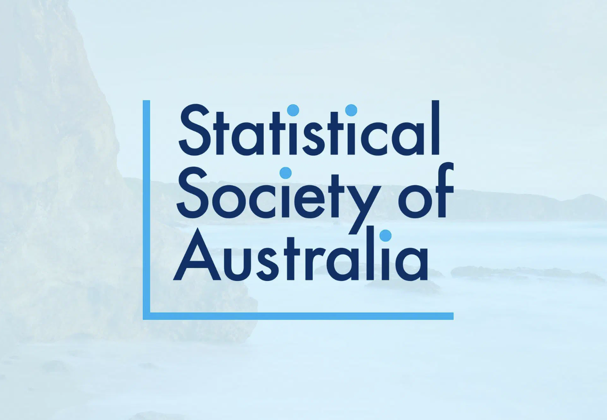
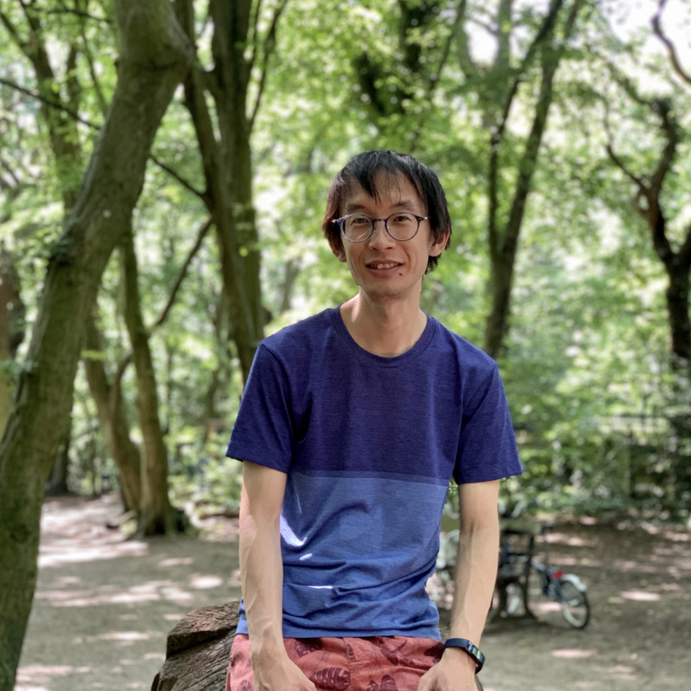
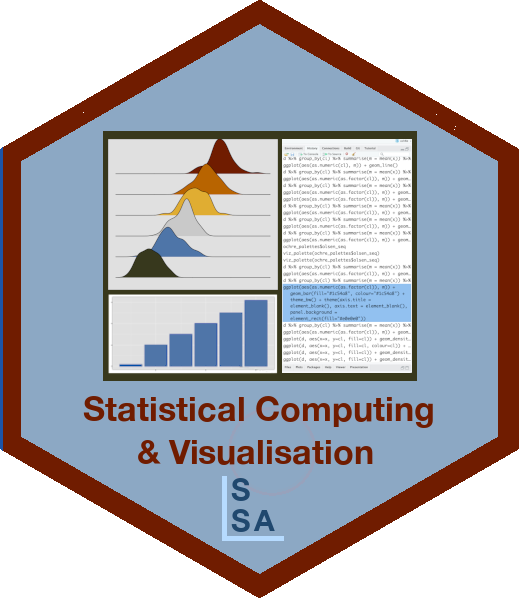
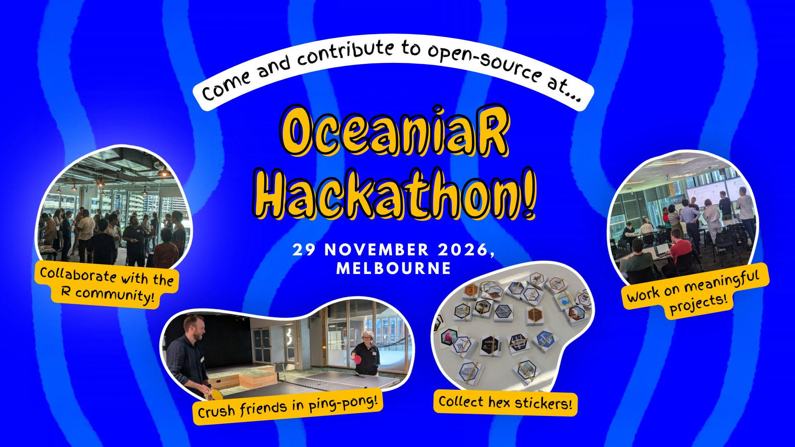
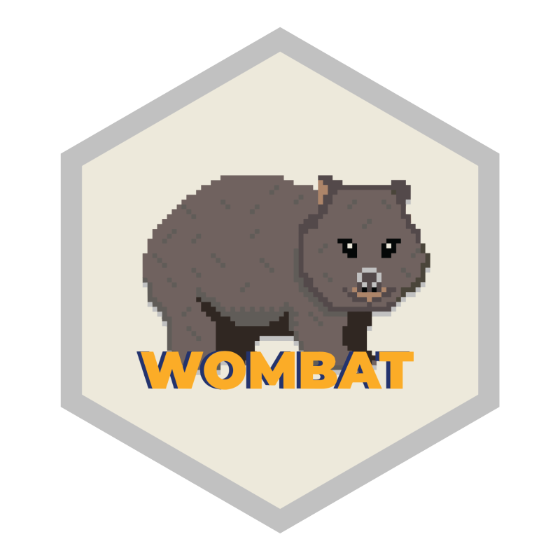

## Code of Conduct {.housekeeping}

::: {.eyebrow}
Before we begin
:::

Please help make this a welcoming session for everyone.

:::: {.columns .housekeeping-layout}
::: {.column .card width="32%"}
<h3>Be respectful</h3>

Treat the speaker and other attendees with care.
:::

::: {.column .card width="32%"}
<h3>Keep questions constructive</h3>

Use the Q&A to ask about ideas and experiences.
:::

::: {.column .card width="32%"}
<h3>Need help?</h3>

Contact Fonti if something in the session concerns you.
:::
::::

[https://statsoc.org.au/Code-of-conduct](https://statsoc.org.au/Code-of-conduct)

## Statistical Society of Australia {.membership}

::: {.eyebrow}
Stay connected
:::

:::: {.columns .membership-layout}
::: {.column .membership-copy width="52%"}
<h3>A community for statistics and data</h3>

The Statistical Society of Australia connects statistics and data professionals through networking, career development, and accreditation resources.
:::

::: {.column .membership-visual width="43%"}
{.membership-image}

::: {.membership-callout}
Interested in joining? See our [website](https://statsoc.org.au/membership_benefits).
:::
:::
::::

## Introducing... {.speaker}

::: {.eyebrow}
Today's speaker
:::

:::: {.columns .speaker-layout}
::: {.column .speaker-copy width="55%"}
<h3>Charlie Gao</h3>

Senior Software Engineer · Posit
:::

::: {.column .speaker-visual width="40%"}

:::
::::

## Q&A {.closing}

::: {.eyebrow}
Over to you
:::

Please use raise your hand or use Q&A function

## What's next for SCDV? {.closing}

::: {.eyebrow}
Upcoming events
:::

:::: {.columns .events-layout}
::: {.column .event-card width="32%"}
**🏆 [Statistical Computing and Visualisation Award](https://statsoc.org.au/Statistical-Computing-and-Visualisation-Award)**

31 October

- Australia students and recent graduates
- Recogise early open-source contributions

{width=70% fig-align="center"}
:::

::: {.column .event-card width="32%"}
**🧑‍💻 [OceaniaR Hackathon](https://statsoc.org.au/event-6818002)**

29 November

- Propose ideas
- Collaborate on meaningful projects
- Build skills and connections

{fig-align="center"}
:::

::: {.column .event-card width="32%"}
**💡 [WOMBAT tutorials](https://wombat2026.numbat.space/program/schedule/)**

30 November

- Publish your software
- Survival Analysis
- Intro to {targets}
- and more!

{fig-align="center"}
:::

::::

